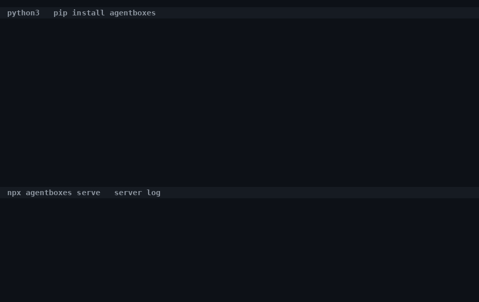

# agentbox

Self-hosted sandboxes for AI agents. It runs on any Linux machine with Docker and gVisor, so you don't need KVM.

Published on npm and PyPI as `agentboxes`.

What you get:

- A sandbox in about 1 ms from the warm pool (130 ms cold), and about 30 ms per command.
- No network by default. You list the hosts a sandbox may reach, and API keys are added by a proxy on the way out, so they never sit inside the sandbox.
- Every sandbox runs under gVisor with a read-only root, no capabilities, no host mounts, memory and CPU limits, and a TTL.
- One npm package with the server, an MCP server for Claude Code and Cursor, and a TypeScript client. There's a Python client too.



## Install

You need Linux, Docker 20+ (28+ if you want the network allowlist) and Node 20+.

```bash
npx agentboxes setup     # installs gVisor if it's missing and checks it works
npx agentboxes serve     # starts the server on http://127.0.0.1:7788
```

`setup` prints every `sudo` command before running it. Use `setup --check` if you only want a report. The server won't start without gVisor.

To keep the `agentbox` command around, run `npm install -g agentboxes`. You then get `agentbox setup`, `serve`, `mcp` and `template build|list`.

By default the server listens on localhost with no auth. To expose it to other machines, set `AGENTBOX_API_KEY` and `HOST=0.0.0.0`. Open `http://127.0.0.1:7788/` for a status page showing live sandboxes, their CPU and memory use, and the pool. Manual gVisor install, the Docker image, keys and logs are covered in [docs/operations.md](docs/operations.md).

## First sandbox

```bash
curl -s -X POST localhost:7788/sandboxes -d '{}'
# {"id":"sbx_...","status":"ready","startup":{"source":"pool","ms":0.3},...}
curl -s -X POST localhost:7788/sandboxes/sbx_.../exec -d '{"cmd":["python","-c","print(2+2)"]}'
# {"exitCode":0,"stdout":"4\n","stderr":"","durationMs":31,"timedOut":false,"truncated":false}
curl -s -X DELETE localhost:7788/sandboxes/sbx_...
```

File upload and download, tar archives, streaming output and the rest of the API are in [docs/api.md](docs/api.md).

## From Claude Code or Cursor

```bash
claude mcp add agentbox -e AGENTBOX_URL=http://127.0.0.1:7788 -- npx -y agentboxes mcp
```

This adds five tools: `run_code`, `run_command`, `write_file`, `read_file` and `reset_sandbox`. Each session gets one sandbox. It's created on the first call and destroyed when the client disconnects. The Cursor config and options (template, allowed hosts, TTL) are in [docs/api.md](docs/api.md).

## From code

```ts
import { Agentbox } from "agentboxes";

const box = await new Agentbox({ baseUrl: "http://127.0.0.1:7788" }).create({ allowHosts: ["pypi.org"] });
await box.uploadDirectory("./myrepo", "repo");
const r = await box.exec(["python", "-m", "pytest"], { cwd: "repo", timeoutMs: 300_000 });
console.log(r.exitCode, r.stdout);
await box.destroy();
```

```python
from agentbox import Agentbox            # pip install agentboxes
box = Agentbox("http://127.0.0.1:7788").create(allow_hosts=["pypi.org"])
print(box.exec(["python", "-c", "print(2+2)"]).stdout)
box.destroy()
```

Neither client has dependencies. See [docs/api.md](docs/api.md) for errors, streaming and every method.

## From an agent framework

There are one-file examples for the [Claude Agent SDK](examples/claude-agent-sdk/agent.py), [OpenAI Agents SDK](examples/openai-agents/agent.py), [LangGraph](examples/langgraph/agent.py) and [Mastra](examples/mastra/agent.ts) (TypeScript). The sandbox part is the same in each:

```python
from agentbox import Agentbox, ExecTimeout
box = Agentbox("http://127.0.0.1:7788").create()

def run_python(code: str) -> str:
    """Runs Python code in an isolated sandbox and returns its stdout and stderr."""
    box.write_file("main.py", code)
    try:
        result = box.exec(["python", "main.py"], timeout_ms=60_000)
    except ExecTimeout as killed:
        result = killed.result
    return result.stdout + result.stderr

agent = create_agent(model="anthropic:claude-opus-5-5", tools=[run_python])   # LangGraph
agent = Agent(name="coder", tools=[function_tool(run_python)])                  # OpenAI Agents SDK
```

```bash
pip install -r examples/langgraph/requirements.txt
ANTHROPIC_API_KEY=... python examples/langgraph/agent.py "Compute the first ten prime numbers and print them."
```

`npm run test:examples` loads the examples against a live server and calls the sandbox tool; no model is involved, so it needs no key. Running an example itself needs your API key. For a fuller coding agent that works on a whole repo, see [docs/examples.md](docs/examples.md).

## Sandbox defaults

| | Default | Env var |
|---|---|---|
| Runtime | gVisor (`runsc-kvm` if available, otherwise `runsc`) | `AGENTBOX_RUNTIME` |
| Network | none, or an allowlist through the egress proxy | |
| Memory | 512 MB, no swap. Going over kills the sandbox. | `DEFAULT_MEMORY_MB`, `MAX_MEMORY_MB` |
| CPUs | 1 | `DEFAULT_CPUS`, `MAX_CPUS` |
| `/workspace` | 1024 MB tmpfs in RAM; the hard memory cap is memory plus this | `DEFAULT_DISK_MB`, `MAX_DISK_MB` |
| Processes | 256. Past that, new processes fail to start; the sandbox keeps running. Zombies are reaped and don't count. | `DEFAULT_PIDS`, `MAX_PIDS` |
| TTL | 10 min, held by the sandbox itself even while the server is down | `DEFAULT_TTL_SECONDS`, `MAX_TTL_SECONDS` |
| Command timeout | 30 s (max 30 min) | `DEFAULT_EXEC_TIMEOUT_MS`, `MAX_EXEC_TIMEOUT_MS` |
| Root filesystem | read-only | |
| User | `nobody`, all capabilities dropped, `no-new-privileges` | |
| Host mounts, Docker socket, host env | none | |

Other settings, with defaults:
- `PORT` (7788), `HOST`, `AGENTBOX_API_KEY`
- `AGENTBOX_IMAGE` (`python:3.12-slim`), `MAX_SANDBOXES` (20), `POOL_SIZES` (`default:3`)
- `MAX_OUTPUT_BYTES` (1 MiB per stream per command; anything past that is dropped and `truncated` is set), `MAX_FILE_BYTES` (8 MiB), `MAX_ARCHIVE_BYTES` (256 MiB)
- `REAPER_INTERVAL_MS` (10000)

## Network and secrets

A sandbox has no network unless you list hosts when you create it:

```bash
curl -s -X POST localhost:7788/sandboxes -d '{"allowHosts":["pypi.org","files.pythonhosted.org"]}'
curl -s -X POST localhost:7788/sandboxes -d '{"secrets":{"api.openai.com":"OPENAI_API_KEY"}}'
```

With `allowHosts`, the sandbox gets its own network where the only thing it can reach is an egress proxy. The proxy allows those hosts on ports 80 and 443 (write `host:port` for another port) and refuses everything else. Refusals are logged at `GET /sandboxes/:id/egress-log`. An allowed hostname that resolves to localhost, the cloud metadata address or a private IP is refused too.

With `secrets`, the server reads `OPENAI_API_KEY` from its own environment and hands it only to the proxy, which adds the header to outgoing requests. The sandbox never sees the key. There's a test that searches the sandbox's environment and files for it and checks it isn't there.

More detail, including custom headers like `x-api-key` and which tools respect the proxy, is in [docs/network.md](docs/network.md).

## Templates

A template is a Docker image with your packages preinstalled:

```bash
agentbox template build data-science ./Dockerfile    # FROM python:3.12-slim, RUN pip install pandas numpy
curl -s -X POST localhost:7788/sandboxes -d '{"template":"data-science"}'
```

There's a Node 22 template in `templates/node/Dockerfile`. Pools per template and `npm ci` notes are in [docs/templates.md](docs/templates.md).

## Performance

Measured through the HTTP API on an i7-12700H laptop (Docker 29, runsc release-20261026.0):

| | p50 | p95 |
|---|---|---|
| create from the warm pool | 1.1 ms | 2.2 ms |
| create cold | 130 ms | 154 ms |
| exec `print(2+2)` | 31 ms | 36 ms |

An idle sandbox uses about 16 MB of host memory. Compared to plain Docker (runc), gVisor makes Python startup about 1.3x slower, `pip install` 1.1x and `npm install` 1.35x (1.12x with KVM).

Run `npm run bench` to reproduce the table. The method, plus KVM and Firecracker numbers, is in [docs/benchmarks.md](docs/benchmarks.md) and [docs/runtimes.md](docs/runtimes.md).

## Limitations

- Single host. One server per Docker host. Sandbox records are in SQLite, and a restarted server picks up the sandboxes that are still running. Restarting Docker, though, loses the egress proxy's state.
- gVisor isn't a VM. It handles most syscalls itself, but some still reach the host kernel. If you need a separate kernel per sandbox, there's a Firecracker runtime, though it doesn't support every feature yet.
- API keys separate users' sandboxes and limits, but everyone shares the same proxy, pool and Docker host, so this isn't strong multi-tenancy.
- `/workspace` lives in RAM. A big `node_modules` or repo uses memory, up to `diskMb`. Going past it gives "no space left", not an OOM kill.
- Nothing inside a sandbox is reachable from outside, and nothing is kept after the TTL, so you can't use it to host previews.

## Docs

- [docs/api.md](docs/api.md): endpoints, both clients, the MCP server
- [docs/operations.md](docs/operations.md): API keys and limits, the status page, logs, the Docker image, restarts
- [docs/network.md](docs/network.md): the allowlist and secret injection
- [docs/templates.md](docs/templates.md), [docs/runtimes.md](docs/runtimes.md), [docs/benchmarks.md](docs/benchmarks.md), [docs/examples.md](docs/examples.md)
- [docs/development.md](docs/development.md): tests, code layout, running from source

MIT license.
